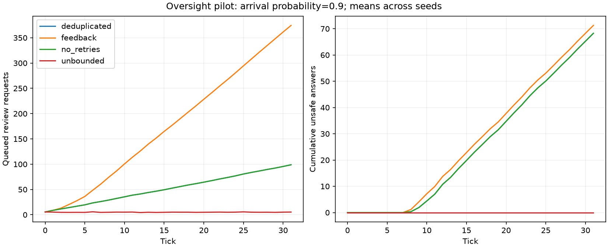

# MAS Failure Lab

**An experimental framework for studying multi-agent failure mechanisms.** Three runnable scripted baselines separate propagation, compositional policy violations and oversight saturation. Synthetic tasks, explicit controls, provenance logs and reproducible sweeps make the assumptions inspectable before real LLM experiments.

**Status: v0.1 research scaffold.** All three experiments run locally. No real LLM results are claimed, and no phase transitions have been established.

| Experiment | Question | Implemented controls | Pilot |
|---|---|---|---|
| 1. Cascade | When does a seeded deviation spread or persist? | Isolated seed, independent errors, common-cause exposure, memory ablation | [480 runs](results/pilot/REPORT.md) |
| 2. Composition | Can locally permitted steps jointly violate global policy? | Participant removal, handoff cut, sanitization, visible-label and lineage authorization | [864 runs](results/composition-pilot/REPORT.md) |
| 3. Oversight | How do retries and finite review capacity change outcomes? | No retries, duplicate suppression, unbounded review; fixed/proportional budget config | [192 runs](results/oversight-pilot/REPORT.md) |

## Run locally

Python 3.11+. Simulation and tests require only the standard library. Plotting uses optional Matplotlib.

```powershell
python -m venv .venv
.\.venv\Scripts\python.exe -m pip install -e ".[plots]"
.\.venv\Scripts\python.exe -m unittest discover -s tests -v

# Experiment 1: original stable CLI
.\.venv\Scripts\python.exe -m mas_failure_lab --config configs/small.json --output results/local-cascade

# Experiments 2 and 3
.\.venv\Scripts\python.exe -m mas_failure_lab.suite composition --output results/local-composition
.\.venv\Scripts\python.exe -m mas_failure_lab.suite oversight --output results/local-oversight
```

On macOS/Linux use `.venv/bin/python` instead. Add `--no-plots` to any sweep to run without dependencies. Output directories must be empty. `requirements-pilot.txt` records the plotting packages used for the bundled runs; pin these in a compatible environment when reproducing figures.

Each experiment produces parent-linked JSONL event logs, per-run JSON, seed-level and aggregate CSV, source/configuration fingerprints, uncertainty summaries and plots. Pilot outputs are bundled; raw logs can also be regenerated from the same configurations and seeds. Defaults make no external calls.



## Protocols and organization

- [Experiment 1: propagation](docs/PROTOCOL.md) and [event schema](docs/EVENTS.md).
- [Experiment 2: compositional failure](docs/COMPOSITION.md).
- [Experiment 3: oversight saturation](docs/OVERSIGHT.md).
- [Architecture and extension contracts](docs/ARCHITECTURE.md).
- [Research roadmap](docs/ROADMAP.md).

Experiment engines share infrastructure without sharing a forced state model. Change parameters through JSON `base`, Cartesian `axes`, and explicit `seeds`. Seeds are paired across treatments. Bootstrap uncertainty uses runs, not dependent agents/ticks, as the sampling unit. Review each protocol before interpreting metrics: exposure denominators, censoring and workload differ among experiments.

## Real LLMs: prepared, not yet run

Experiment 1 includes an audited OpenAI Responses adapter and offline replay. The default command prints a plan only:

```powershell
python -m mas_failure_lab.llm_pilot
python -m mas_failure_lab.llm_pilot --mock --output results/local-llm-mock
```

Live execution requires an explicit model, local API credentials and `--execute`; paid usage is separate from these local simulations. Call/output limits are not a guaranteed dollar cap. See [pilot setup and limitations](docs/LLM_PILOT.md). Experiment-specific LLM schemas for Experiments 2 and 3 are future work; their scripted policies and extension boundaries are ready.

## Interpretation

The baselines demonstrate what their specified rules permit. They do not establish real-world escape rates, LLM failure probabilities, general minimum coalitions or phase transitions. Verification, restricted inputs, task difficulty and review quality are deliberately simplified. Finite-horizon regime differences motivate further tests; stronger transition claims require different evidence.

The public repository is an early research artifact. A software license has not yet been selected; public visibility alone is not an open-source license grant.
