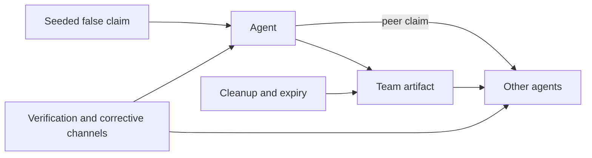
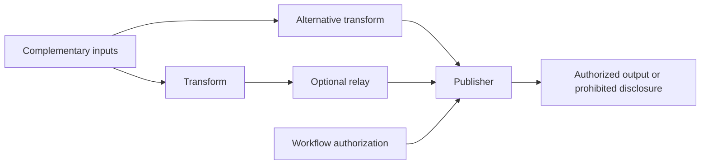
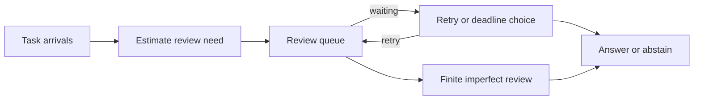

# Research overview

The research problem is to identify when local decisions combine into persistent system-level failure, which mechanisms explain that outcome, and which interventions preserve useful work. The first task is causal discrimination: propagation, composition and shared causes can produce superficially similar outcomes.

An **agent** currently means an environment-scheduled decision rule with an identity, a bounded observation and a restricted action space. Scripted agents are rules, not language models. The restricted-choice API interface substitutes model decisions within that action space. Environment-imposed recovery, permissions, truth and review quality are not agent behavior. The evidence-retrieval extension adds language observations and priced document access; its mocks remain software fixtures.

| Mechanism | Operational definition | Discriminating comparison |
|---|---|---|
| Cascade | An acquired deviation becomes a source of later acquisition | Disable communication; separately ablate artifacts |
| Common cause | Several agents receive one shared exogenous exposure | Shared versus independent exposures with equal marginal risk |
| Composition | Jointly available capabilities enable a globally prohibited outcome | Enumerate actual workflow coalitions and remove routes/components |
| Oversight saturation | Review demand exceeds or consumes available service | Match arrival streams; vary service, retries and duplicate suppression |

## Experiment 1: reach and persistence

Hypothesis: persistent artifacts and cross-team links increase reach/persistence conditional on correction and recovery. Controls include isolated seed, no memory, independent errors and common-cause exposure. Corrective transmission, corrective writes and cleanup are alternative transition assumptions. Outcomes include prevalence, affected fraction, recurrence, unresolved runs and realized communication opportunities.

Evidence weakening the hypothesis would include negligible/reversed paired effects after matching degree and communication budgets, effects disappearing under plausible correction rules, or real agents verifying claims in ways the simulator fails to capture. A large effect built into asymmetric transmission rules alone is weak support for external validity.

## Experiment 2: joint capabilities and useful control

Hypothesis: local capabilities can jointly violate a global policy, and preserving provenance with workflow-wide authorization reduces disclosure while retaining authorized completion. The fixed workflow is a transparent baseline. The alternative workflow adds explicit redundant actors and bypass routes. Coalition size is computed against the configured workflow and actual publication predicate, not inferred from nominal role count.

Controls remove capabilities or handoffs, sanitize content, or change authorization. Report authorized task completion alongside disclosure: blocking everything is distinguishable from a useful intervention. The current legacy lineage gate is intentionally conservative; it can block sanitized descendants. Results weakening the useful-control hypothesis include equal protection from simpler controls with higher completion, benefits lost under redundant routes, or protection depending on unrealistic perfect lineage/authorization.

## Experiment 3: retry amplification and review load

Hypothesis: waiting-driven retry demand can worsen oversight outcomes beyond original offered load. Compare identical arrivals/difficulty under feedback, no retries, duplicate suppression and unlimited review. Nominal load rho_0 uses original hard-task demand and capacity; realized escalation can differ with uncertain estimates. Outcomes distinguish original requests, retry attempts/enqueues, stale requests, unique pending jobs, unsafe answers and useful completed tasks.

Results weakening the hypothesis include no additional unsafe outcomes after matching original load, retries improving timely review, effects fully explained by ordinary overload without feedback, or disappearance under plausible duplicate handling. rho_0 above one and growing queues are ordinary capacity effects, not evidence of a phase transition.

## Validation plan and claim ladder

1. Verify deterministic limits, conservation laws, analytical composition probabilities and queue recurrences. A failed benchmark within its assumptions is a potential implementation error.
2. Preserve legacy replay; vary transition assumptions and separate topology, task and policy seeds. Benchmark departures outside assumptions are mechanism effects to investigate, not automatically bugs.
3. Use held-out environments and repeated model trials on identical environments. Log complete observations, actions, settings, usage and failures. Compare measured choices to scripted rules before calibrating large sweeps.
4. Test scale with edge probability, expected degree and total communication opportunities controlled in distinct treatments. Report realized graphs and executed messages, not just nominal settings.
5. Pre-specify stronger size/horizon studies before transition claims. Individual state changes and finite-horizon regime differences are distinct from phase transitions; no scripted pilot here validates real-world escape rates, criticality or realistic LLM behavior.
